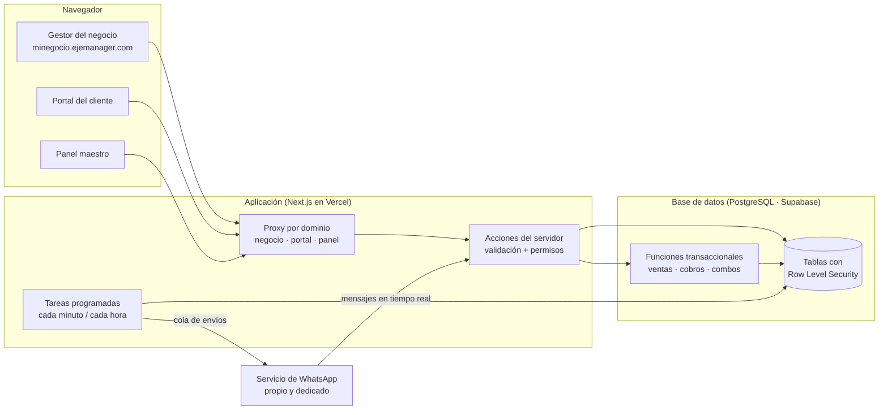

# EJE Manager

**El sistema con el que los negocios de cuentas de streaming dejan de vivir en Excel, notas del celular y chats perdidos.**

EJE Manager es una plataforma en la nube para vender y administrar cuentas de streaming (Netflix, Disney+, Max, Spotify, IPTV…): inventario de cuentas y perfiles, clientes y revendedores, ventas, vencimientos, cobros, mensajes por WhatsApp y portal para el cliente. Cada negocio tiene su propio gestor, con su marca y su dominio, completamente separado de los demás.

> Este repositorio es una **vitrina técnica**: explica cómo está construido el sistema y muestra ejemplos reales de su código. El código completo es privado.

---

## Lo que resuelve

Un negocio de streaming maneja cientos de cuentas, miles de perfiles y clientes que vencen todos los días. El problema nunca es vender: es **no perder el control**.

| Antes | Con EJE Manager |
|---|---|
| Contraseñas en una hoja de cálculo que cualquiera copia | Contraseñas **cifradas**; cada consulta queda registrada |
| «¿A quién le vence hoy?» revisando chats | Pantalla de **vencimientos** por día, con recordatorio en un toque |
| Cambias la clave de una cuenta y avisas uno por uno | El sistema sabe **a quién afecta** y le manda sus datos nuevos solo |
| Revendedores que no saben qué cobrar | Cada revendedor recibe **un solo mensaje** con lo que vence de sus clientes |
| Deudas en la memoria | **Cobros** con lo pendiente de cada cliente y su historial |
| El cliente pregunta su clave a medianoche | **Portal del cliente**: ve sus accesos y vencimientos con un enlace seguro |

## Qué incluye

- **Inventario:** cuentas, perfiles, PIN, planes familiares, líneas IPTV, proveedores y costos.
- **Ventas:** perfil, cuenta completa, varias pantallas en una venta o **combos** (2 a 6 servicios como una unidad).
- **Vencimientos y renovaciones:** por día, de a una o **varias a la vez**, con el mensaje listo.
- **Cobros y movimientos:** deudas, pagos parciales, saldo a favor, mora y reportes.
- **Clientes y revendedores:** fichas completas, clientes finales de cada revendedor e importación desde Excel.
- **Portal del cliente:** con la marca del negocio, verificación opcional y enlace de un solo propietario.
- **WhatsApp integrado:** chat tipo WhatsApp Web dentro del gestor (dos números: normal y Business), plantillas, campañas y **automatizaciones** (recordatorios, vencidos, entrega de accesos al vender, cobros, cambio de contraseña y confirmación de pago).
- **Equipo:** administradores y vendedores con permisos distintos (un vendedor **nunca ve costos ni ganancias**).
- **Dominio propio:** cada negocio puede usar su subdominio o su propio dominio.
- **Panel maestro:** la plataforma administra negocios, planes, pagos, soporte por tickets y avisos.

---

## Cómo protege los datos

La seguridad no es una pantalla de login: está en cada capa.

1. **Aislamiento entre negocios en la base de datos.** Cada tabla lleva el negocio dueño de cada fila y la base de datos aplica **Row Level Security**: aunque hubiera un error en la aplicación, la base de datos no le entrega a un negocio los datos de otro. Hay **169 pruebas automáticas** dedicadas solo a intentar romper ese aislamiento.
2. **Credenciales cifradas con AES-256-GCM.** Las contraseñas de las cuentas, los PIN y los tokens nunca se guardan en texto plano. La llave vive solo en el servidor.
3. **Vendedores con lo justo.** Un vendedor ve sus clientes y sus ventas; no ve costos, ganancias ni la configuración del negocio.
4. **Freno a la extracción masiva.** Si alguien consulta muchas contraseñas seguidas, el sistema pausa su acceso y avisa al administrador.
5. **Verificación en dos pasos** para administradores y obligatoria en el panel maestro.
6. **Registro de actividad** de cada acción sensible: quién, qué, cuándo y desde dónde.
7. **Portal del cliente con enlaces no adivinables**, que se pueden revocar y regenerar.

---

## Arquitectura



- **Un dominio, muchos negocios:** el proxy identifica el negocio por el dominio de cada visita y la sesión debe pertenecer a ese negocio.
- **Operaciones que no se pisan:** asignar un perfil, cobrar o vender un combo son funciones de la base de datos con bloqueo de filas. Dos vendedores no pueden vender el mismo perfil al mismo tiempo, y un combo se asigna completo o no se asigna.
- **WhatsApp por cola:** todo mensaje automático entra a una cola con clave única (nunca sale dos veces), respeta horario y límites por hora y por día, y sale con pausas al azar para cuidar el número.

---

## Ejemplos de código

Fragmentos reales del sistema (sin datos ni llaves).

### 1. Cifrado de credenciales (AES-256-GCM)

```ts
// Formato guardado: v1:<iv>:<tag>:<cifrado>. Solo servidor.
export function cifrar(texto: string, claveBase64: string): string {
  const iv = randomBytes(12);
  const cipher = createCipheriv("aes-256-gcm", clave(claveBase64), iv);
  const cifrado = Buffer.concat([cipher.update(texto, "utf8"), cipher.final()]);
  const tag = cipher.getAuthTag();
  return [VERSION, iv.toString("base64url"), tag.toString("base64url"), cifrado.toString("base64url")].join(":");
}
```

### 2. Aislamiento en la base de datos (Row Level Security)

```sql
-- Solo las filas del propio negocio; un vendedor, además, solo sus propios clientes.
-- La regla la aplica PostgreSQL en cada consulta, no la aplicación.
create policy clientes_select on public.clientes for select to authenticated
  using (
    (negocio_id = (select app.negocio_actual()) and ((select app.es_admin()) or vendedor_id = (select auth.uid())))
    or (select app.es_superadmin())
  );
```

### 3. Quién recibe cada mensaje automático

```ts
/** Entrega y datos nuevos con «todos» o «solo accesos»; lo demás solo con «todos». */
export function recibeAutomatico(
  preferencia: string | null | undefined,
  tipo: "recordatorio" | "vencido" | "cobro" | "pago" | "entrega" | "clave",
): boolean {
  const p = esMensajesAuto(preferencia) ? preferencia : "todos";
  if (p === "ninguno") return false;
  if (p === "entregas") return tipo === "entrega" || tipo === "clave";
  return true;
}
```

### 4. Formato de WhatsApp en el editor de mensajes

```ts
/** Envuelve lo seleccionado con *negrita*, _cursiva_, ~tachado~…; si ya estaba, lo quita. */
export function envolver(texto: string, inicio: number, fin: number, tipo: Envoltura): Edicion {
  const marca = ENVOLTURAS[tipo];
  let a = Math.min(inicio, fin);
  let b = Math.max(inicio, fin);
  while (a < b && /\s/.test(texto[a]!)) a++;
  while (b > a && /\s/.test(texto[b - 1]!)) b--;
  if (texto.slice(a - marca.length, a) === marca && texto.slice(b, b + marca.length) === marca) {
    return { texto: texto.slice(0, a - marca.length) + texto.slice(a, b) + texto.slice(b + marca.length), inicio: a - marca.length, fin: b - marca.length };
  }
  return { texto: texto.slice(0, a) + marca + texto.slice(a, b) + marca + texto.slice(b), inicio: a + marca.length, fin: b + marca.length };
}
```

---

## Calidad

| | |
|---|---|
| Pruebas automáticas | **418** (reglas de negocio, mensajes, fechas, permisos y aislamiento) |
| Pruebas de aislamiento entre negocios | **169** |
| Cambios de base de datos versionados | **96** migraciones, aplicadas primero en pruebas y luego en producción |
| Tipado | TypeScript estricto en todo el sistema |
| Interfaz | Español, modo claro, oscuro y automático, celular y computador |

## Tecnología

Next.js · React · TypeScript · Tailwind CSS · PostgreSQL (Supabase) con Row Level Security · Vercel · servicio de WhatsApp propio · Vitest.

---

**EJE Manager** · [ejemanager.com](https://ejemanager.com)

*El código completo de la plataforma es privado. Este repositorio solo explica cómo está construida.*
